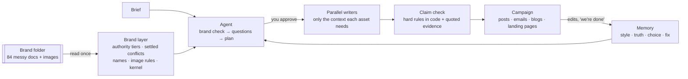

# Lloyd: the brand-aware campaign agent

A local chat app where a marketer and an AI agent plan and write a campaign for a brand. It works from a large, messy brand folder by compiling it once into a **brand layer** (authority order, settled conflicts, names, rules, image rules, a short brand kernel), then pulling in only the parts each step needs.

Chat on the left, assets on the right: LinkedIn and X posts, emails, blog posts and landing pages, drawn the way they'd look when published, in the brand's own colours and fonts. Every model call is logged with its exact prompt, tokens, cache hits and cost.



More diagrams (state machine, routing, claim check, retrieval, memory, models, data model) are in [docs/ARCHITECTURE.md](docs/ARCHITECTURE.md).

## Run it

Requires **Node 22+** (see `.nvmrc`).

```bash
cp .env.example .env        # add OPENAI_API_KEY and FIRECRAWL_API_KEY
npm install
npm run dev                 # http://localhost:3000 is the landing page, the app is at /app
```

Put the brand folder at `./wickhold-candidate-package/candidate` (the default), or point `BRAND_DIR` in `.env` at any other brand folder.

**Or with Docker:**

```bash
cp .env.example .env
docker compose up --build   # http://localhost:3000/app
```

The brand folder is mounted read-only (default `./wickhold-candidate-package/candidate`; set `BRAND_FOLDER=/path/to/brand` for another). Campaigns and logs live in the `lloyd-data` and `lloyd-logs` volumes; the image contains no keys or brand content.

**First run on a brand.** The sample brand's index ships in `seed/`, so a fresh clone starts instantly with no API calls. Any other folder opens an indexing screen first: a few minutes and about $1–3 for a 100k-token folder, once. The index is keyed by a hash of the folder's contents, so changing a file triggers a fresh index.

**Another brand.** Brand box → **Switch brand**: a brand used before, the bundled mini test brand (`fixtures/mini-brand`), any folder path, or upload a folder from the browser. Campaigns and memory are kept per brand.

## What the brief asked for, and where it is

| Brief | In Lloyd | Code |
|---|---|---|
| Brand layer: right parts in context, images, contradictions | Compiled once (authority, facts, conflicts, names, kernel, image rules); per-asset retrieval; **Brand** panel shows all of it | `src/lib/brand/` |
| Ask questions only when needed | At most 3, only if the answer changes the plan, each with a default ("use defaults" works) | `src/lib/agent/steps/questions.ts` |
| Brief vs. brand rules | **Brand check** card before planning: what it won't do, the quoted rule, the alternative | `src/lib/agent/steps/brand-check.ts` |
| Propose assets (social, blog, landing, email only) and adjust before writing | **Plan** card with cost estimate; remove items or ask for changes; nothing is written before Approve | `src/lib/agent/steps/planner.ts` |
| Write with web research | Parallel writers, Firecrawl research with source checks, then a claim check with one automatic fix | `src/lib/agent/steps/writer.ts`, `research.ts`, `guard.ts` |
| Render like the real thing, chat left, asset right | LinkedIn, X, email client, blog article and web page renderers in the brand's tokens | `src/components/assets/renderers/` |
| Edits in chat touch one asset | Edits are patches on one asset, saved as a new version with a diff and undo | `src/lib/agent/steps/editor.ts` |
| Memory across chats, visible and editable | Proposed at the end of a campaign, kept only if you keep them; **Memory** panel to view, add, edit, pin, forget | `src/lib/memory/` |
| Tokens and cost per step, prompt caching | Every call logged; **Inspector** shows the exact prompt block by block and cost by step | `src/lib/llm/client.ts` |
| See the exact prompt | Inspector, each asset's **Prompt** tab, and `logs/calls.jsonl` | `src/components/inspector/` |
| OpenAI only, models per task | Four tiers, reasons in DECISIONS.md | `src/lib/llm/models.ts` |
| One command, no brand details hardcoded | `npm run dev`; nothing brand-specific in code (a second brand in `fixtures/mini-brand` proves it) | |

## Using it

1. **New campaign**, then paste a brief, attach a brief file (PDF, Word, PowerPoint, Markdown, text), or click a sample brief.
2. The **Brand check** card lists what Lloyd won't do as written, with the rule, its source and the alternative.
3. **Questions** only if the answers change the plan, each with a default.
4. The **Plan** shows each asset with its audience, angle and date, plus a cost and time estimate. Approve it, remove items, or ask for changes in chat.
5. Assets are written in parallel and stream in live, then are checked against brand and legal rules. Blocking problems get one automatic fix.
6. Edit in chat ("shorten the second LinkedIn post"). Only that asset changes. Off-brand requests ("make it Gen Z with emojis") ask first.
7. Say "we're done". Lloyd proposes what to **remember**; keep or forget each item. Saying "remember …" at any point saves it at once.

Sidebar: **Brand** (which document wins and why, settled conflicts, names, excluded images, the kernel), **Memory**, **Inspector** (every call's exact prompt and cost). Each asset has **Preview**, **Changes**, **Checks**, **Sources** and **Prompt** tabs. **Share** opens the chat to others on the same network and exports it as Markdown or JSON.

## Docs

| | |
|---|---|
| [DECISIONS.md](DECISIONS.md) | How the brand layer and memory work and why, conflicts, what's left out, where AI tools led me wrong, two more weeks |
| [COSTS.md](COSTS.md) | Tokens, cost and cache hit rate per brief, cost of an edit, ingest cost |
| [docs/ARCHITECTURE.md](docs/ARCHITECTURE.md) | Diagrams: system, ingest, state machine, a chat turn, edits, prompt layers and caching, data model, shared chats |
| [docs/EXPLANATION.md](docs/EXPLANATION.md) | How it is built, start to finish, with the JSON passed between steps |
| [docs/GUIDE.md](docs/GUIDE.md) | Every feature and how to test it |
| [docs/BUILD-LOG.md](docs/BUILD-LOG.md) | Day-by-day log of what was measured and changed |
| [fixtures/test-briefs/](fixtures/test-briefs/README.md) | Nine extra briefs (messy, vague, traps, out-of-scope channels) with an answer key |

## Scripts

| Command | What it does |
|---|---|
| `npm run dev` | The app |
| `npm run ingest` | Build or load the brand index and print what it found. `-- --redo conflicts,kernel` redoes only those steps; `-- --force` rebuilds everything |
| `npm run brief -- <brief.md> [--answers "…"] [--edit "…"] [--finish --accept-memories]` | Run a brief end to end in the terminal |
| `npm run eval` | Behaviour checks per brief (`evals/*.json`): questions asked, traps refused, banned content absent, edits touch one asset, memory carries over |
| `npm run bench` | Same runs, then writes `COSTS.md` |
| `npm run seed` | Pack the current brand index into `seed/` |
| `npm run test:keys` | Smoke-test the API keys, models, caching, Firecrawl and vision |
| `npm run export -- --data <dir> --out <dir>` | Write every campaign in a data directory as Markdown |
| `npm test`, `npm run lint`, `npm run typecheck` | Unit tests, lint, types |

## Where things are

```
src/lib/llm/        the only door to the model: tiers, caching, spend cap, logging, pricing
src/lib/brand/      ingest: scan, chunk, doc cards, governance, facts, conflicts, entities, kernel, images, retrieval
src/lib/agent/      state machine and steps: intake, brand check, questions, plan, write, guard, edit, research, router
src/lib/memory/     memory store and end-of-campaign extraction
src/lib/text/       small text helpers (plain punctuation, partial JSON while streaming)
src/components/     chat, asset renderers, inspector, panels, landing page
src/app/api/        route handlers (campaigns, messages over SSE, pulse, export, share, assets, brand, memories, uploads)
scripts/            ingest, brief, eval and bench, seed, test-keys, export
evals/              per-brief expectations for npm run eval (test data; the app never reads them)
fixtures/           mini-brand (a second brand), mock-briefs and their results, test-briefs with an answer key
seed/               the sample brand's index, so a fresh clone starts instantly
```

Logs: `logs/calls.jsonl` (every call, with full request and response) and the `llm_calls` table in `data/app.db`.

## Models

All OpenAI, chosen per task (`src/lib/llm/models.ts`, override with `MODEL_*` env vars). Reasons are in [DECISIONS.md](DECISIONS.md).

| Tier | Default | Used for |
|---|---|---|
| writer | gpt-6.1-sol | asset writing and edits |
| reasoner | gpt-6.1-sol | plan, brand check, questions, governance, kernel |
| fast | gpt-6.1-terra | intake, routing, claim check, fact extraction, conflicts, vision, memory |
| bulk | gpt-6-luna | doc cards, image-rule parsing |
| embed | text-embedding-3-small | retrieval |
