# Architecture

Lloyd is one Next.js process: React UI, API routes, and an agent library in the same TypeScript codebase, with two SQLite databases on disk. All diagrams below are Mermaid, so GitHub renders them inline.

- [1. System overview](#1-system-overview)
- [2. Brand layer: ingest pipeline](#2-brand-layer-ingest-pipeline)
- [3. Campaign state machine](#3-campaign-state-machine)
- [4. One chat turn](#4-one-chat-turn)
- [5. Editing an asset](#5-editing-an-asset)
- [6. Prompt layers and caching](#6-prompt-layers-and-caching)
- [7. Data model](#7-data-model)
- [8. Shared chats: live sync](#8-shared-chats-live-sync)
- [9. Which document wins](#9-which-document-wins)
- [10. Retrieval at write time](#10-retrieval-at-write-time)
- [11. Writing and the claim check](#11-writing-and-the-claim-check)
- [12. Routing a chat message](#12-routing-a-chat-message)
- [13. Memory lifecycle](#13-memory-lifecycle)
- [14. Models per step](#14-models-per-step)
- [15. Code map](#15-code-map)

## 1. System overview

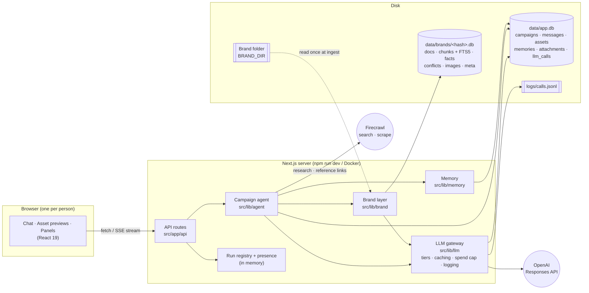

Every model call goes through `src/lib/llm/client.ts`, which picks the model for a tier, places cache breakpoints, enforces the per-run spend cap, honours Stop (AbortSignal), and logs the exact request, tokens, cache hits and cost.

## 2. Brand layer: ingest pipeline

Runs once per brand folder, keyed by a hash of the folder's contents. Each step is resumable and can be redone on its own (`npm run ingest -- --redo conflicts,kernel`).

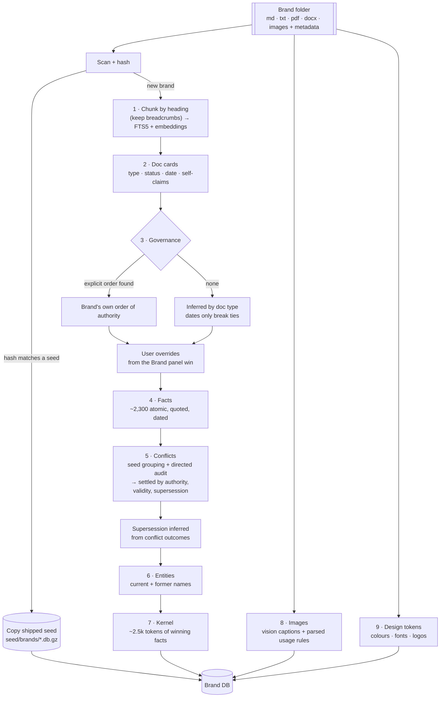

## 3. Campaign state machine

Every message goes through a router that may only pick actions allowed in the current state. Nothing is written before the plan is approved.

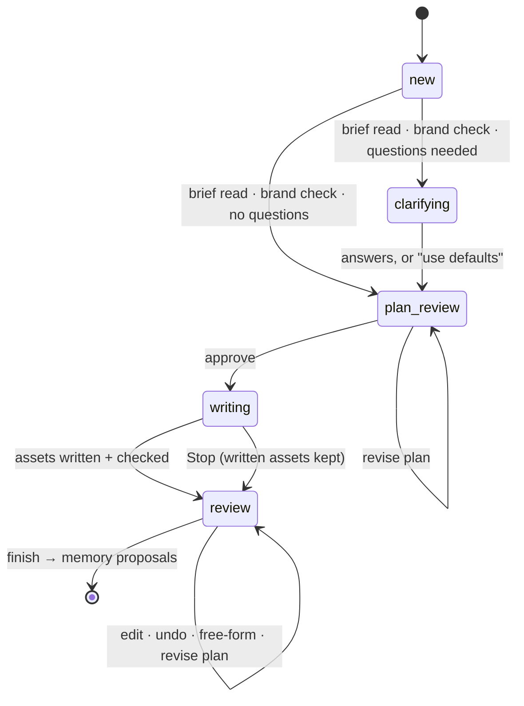

## 4. One chat turn

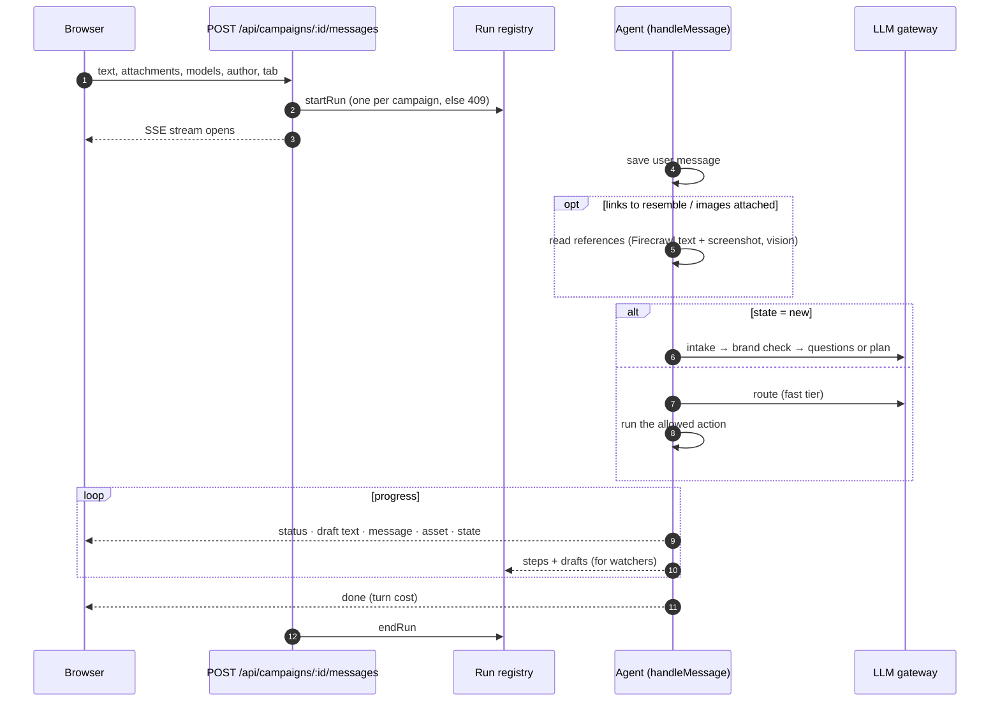

A run keeps going if the browser reloads or closes; Stop aborts its signal and every in-flight model call.

## 5. Editing an asset

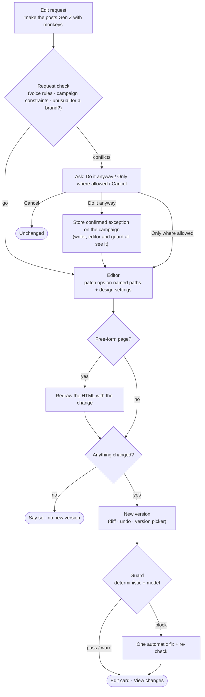

## 6. Prompt layers and caching

Each prompt is built from blocks, most stable first, with a cache breakpoint after each, so parallel writers and later edits read the shared prefix from cache.

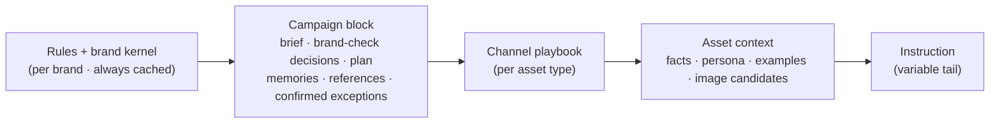

The writer's output schema is part of the cached prefix, so the cache is warmed once per asset type before parallel writing. Cache writes are priced; the Inspector shows every block and its cache status.

## 7. Data model

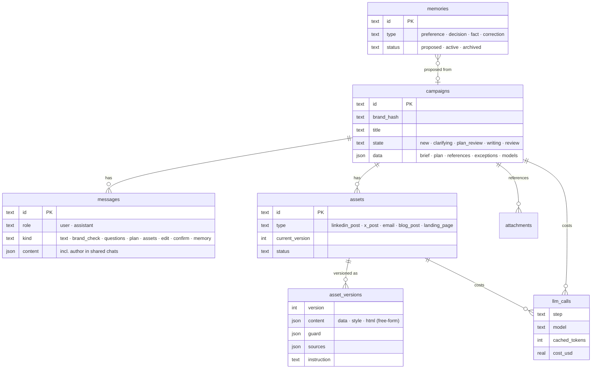

The brand database (`data/brands/<hash>.db`) is separate and read-only at runtime: `docs`, `chunks` + `chunks_fts`, `facts`, `conflicts`, `images`, and `meta` (governance, kernel, entities, design tokens).

## 8. Shared chats: live sync

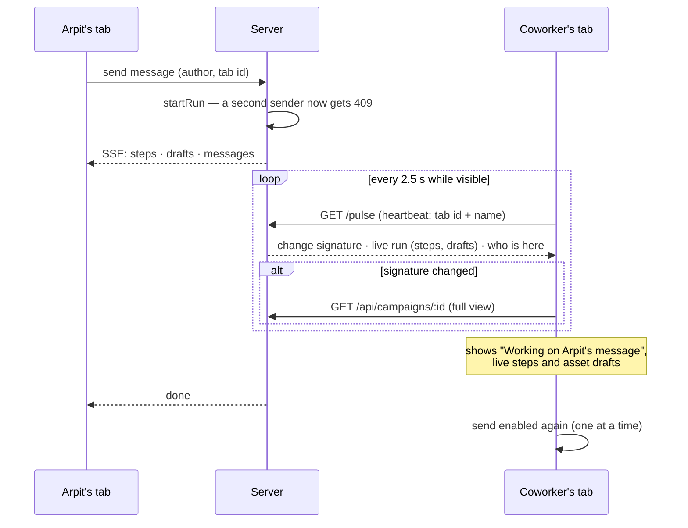

There are no accounts: anyone who can reach the machine on the network can open the link and use the API key. The Share panel says so.

## 9. Which document wins

Brand folders contradict themselves. Ingest decides once which document outranks which, then settles every contradiction with that order. A file called `FINAL` or a newer date only breaks ties.

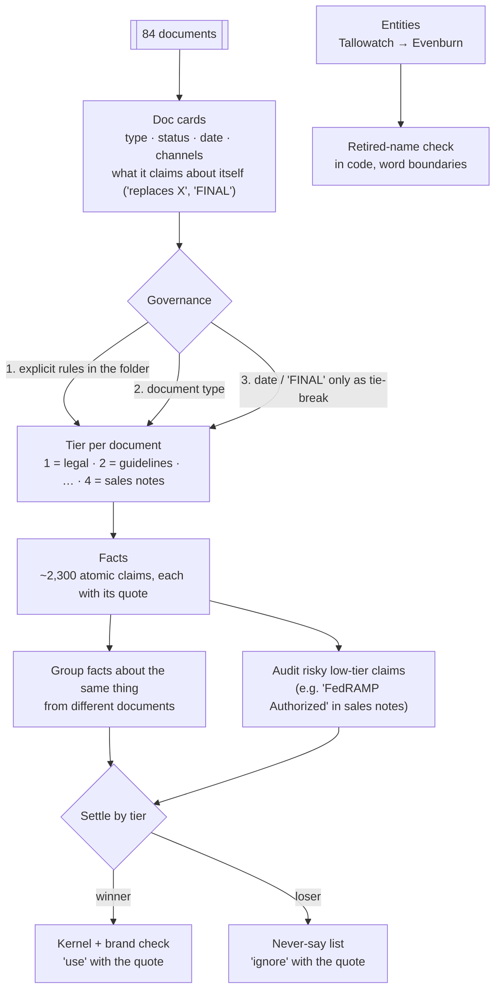

## 10. Retrieval at write time

The kernel is always in the prompt; everything else is looked up per asset. Two searches are fused so exact names and paraphrases both hit, and filters keep old campaign copy from posing as rules.

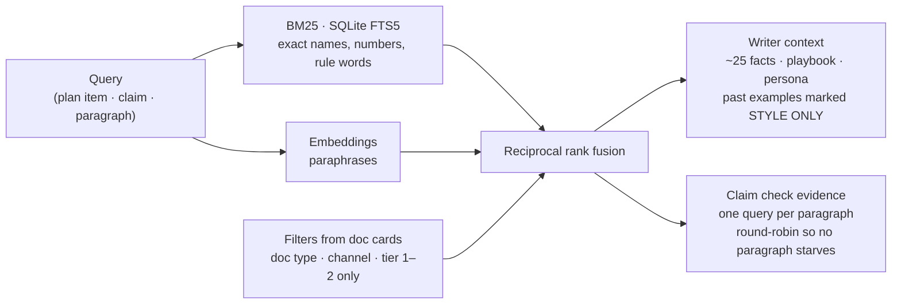

## 11. Writing and the claim check

Every asset is written in parallel from a shared, pre-warmed cache prefix, then checked twice: hard rules in code, judgment by a model that must quote both the copy and the rule. A blocking issue gets one automatic fix and a re-check; anything left is shown, never hidden.

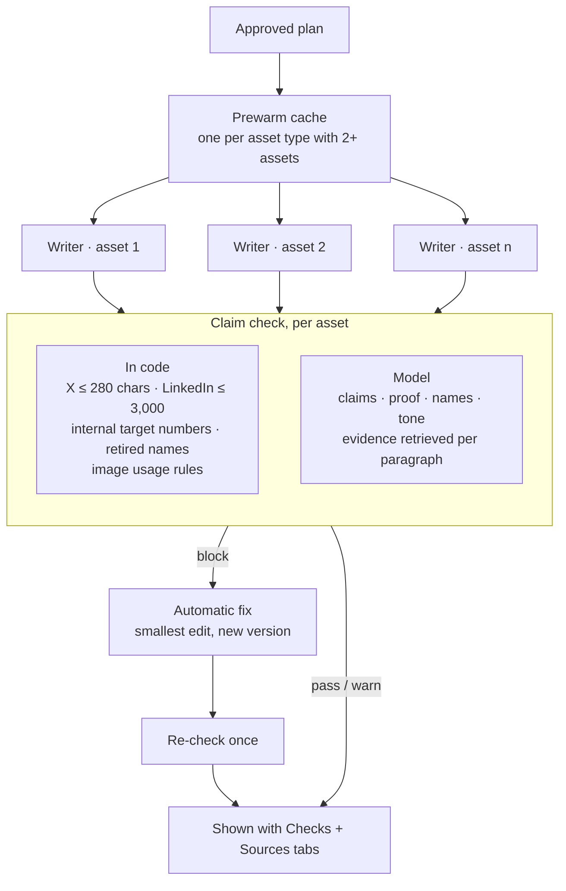

## 12. Routing a chat message

After the first brief, every message is routed to one action the current state allows. Two loops are closed in code: a reply to "are you sure?" is matched before routing, and a reply to the router's own clarifying question is routed together with the original request, so the same question is never asked twice.

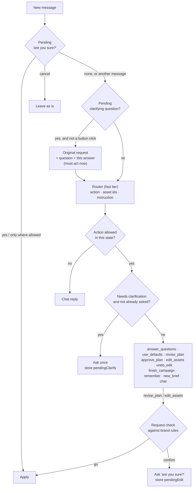

## 13. Memory lifecycle

Memory is small and visible. Nothing becomes active without the marketer, except what they explicitly asked to remember. Campaign-only exceptions never become memories.

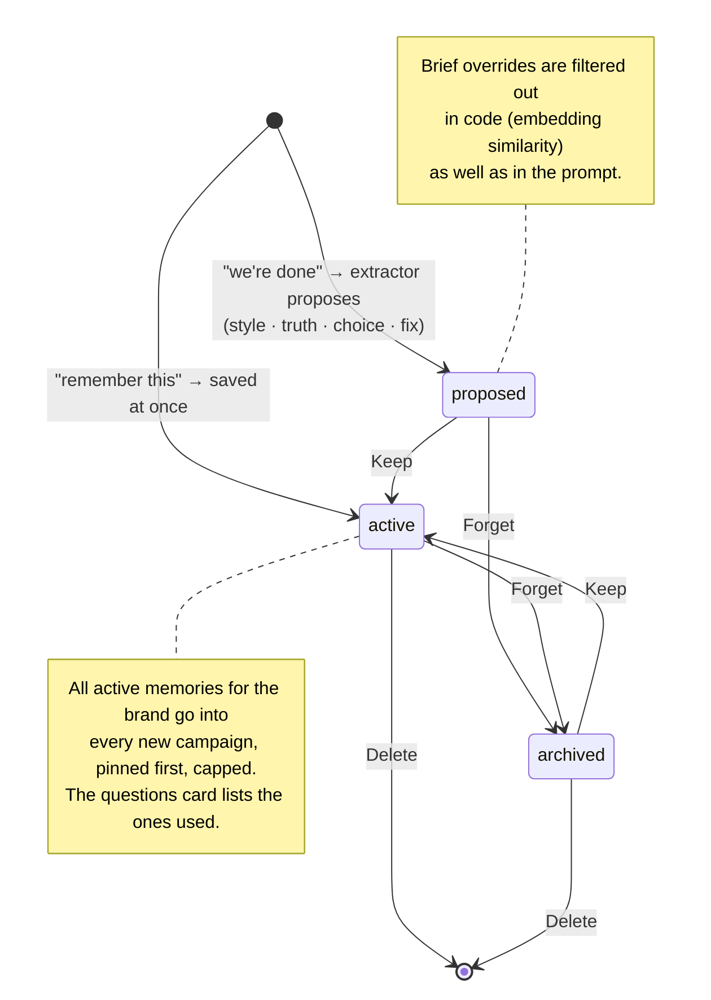

## 14. Models per step

Steps ask for a tier, not a model, so the campaign's model picker can swap models without touching the steps. Every call is priced and logged, which is what the Inspector's *Cost by step* shows.

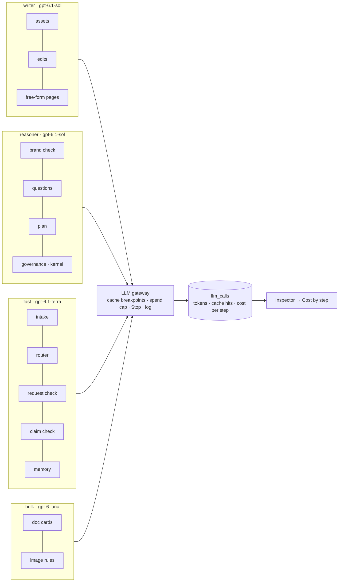

## 15. Code map

| Path | What lives there |
|---|---|
| `src/app/api/` | Route handlers: campaigns, messages (SSE), pulse, export, share, assets (+ free-form), brand, memories, uploads, calls, models, images |
| `src/lib/llm/` | The only door to the model: tiers, catalog, pricing, caching, budget, logging, embeddings |
| `src/lib/brand/` | Ingest: scan, loaders, chunk, cards, governance, facts, conflicts, entities, kernel, images, design tokens, retrieval |
| `src/lib/agent/` | State machine and steps: intake, brand check, questions, planner, writer, guard, editor, request check, free-form, research, references, router; runs, presence, design settings |
| `src/lib/memory/` | Memory store and end-of-campaign extraction |
| `src/components/` | Chat, composer, message cards, run steps; asset panel and renderers; brand, memory, inspector, settings and share panels; themes |
| `scripts/` | `ingest`, `brief`, `eval` / `bench`, `seed`, `test-keys`, contrast sweep |
| `evals/` · `fixtures/` | Eval specs per brief; a second mini brand; mock briefs |
| `docs/` | Guide, decisions, costs, notes, plan, recording script, this file |
